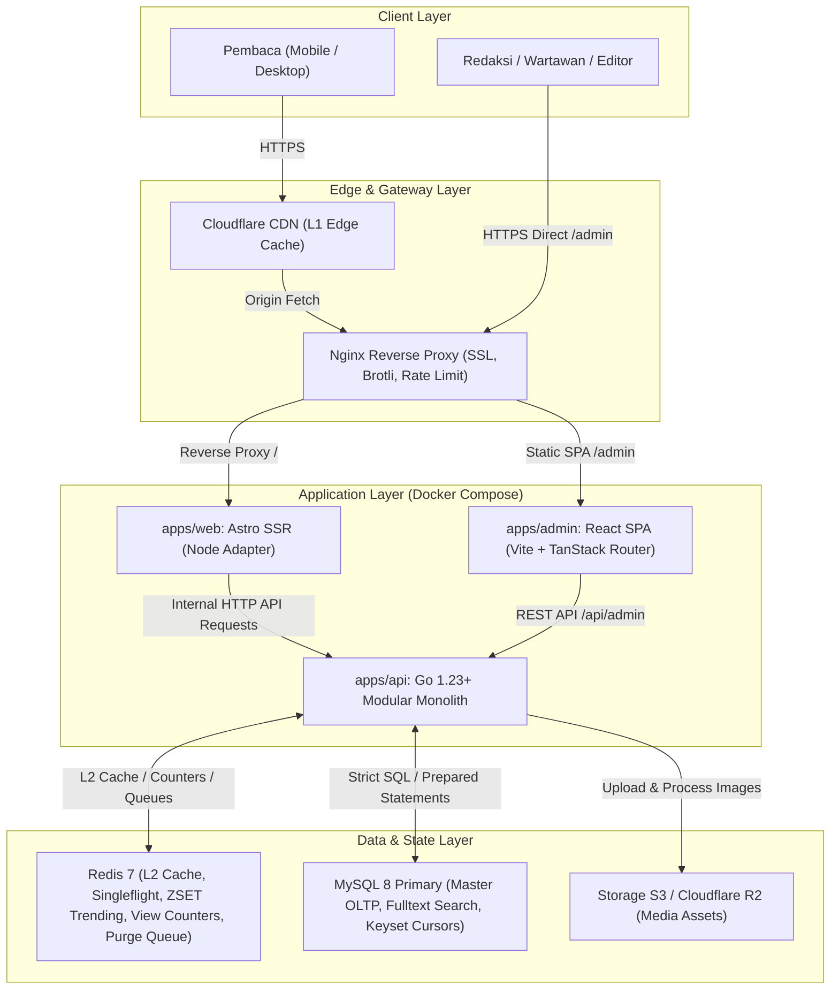
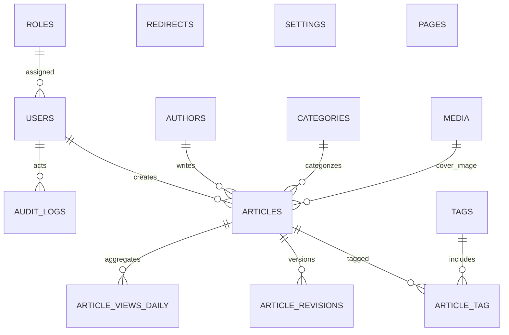
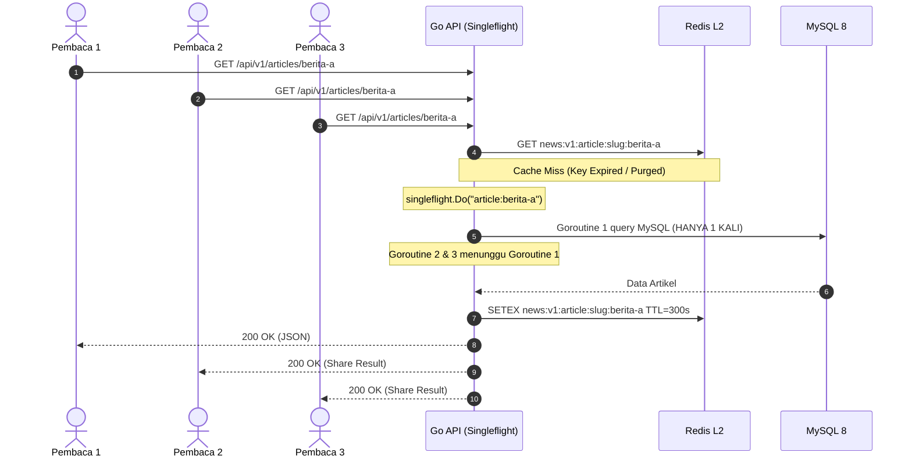
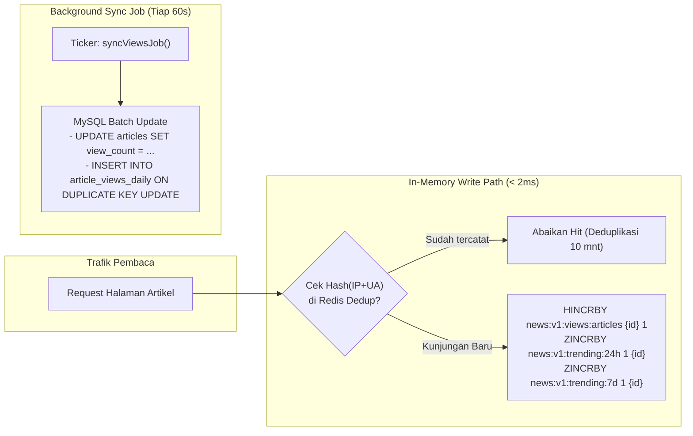

# Portal Berita Modern (Enterprise News Platform)
## System Architecture & Technical Specification

> **Dokumen Arsitektur & Spesifikasi Produksi**  
> **Status:** Menunggu Persetujuan (Pending User Approval)  
> **Target Performa:** LCP < 1,5s | CLS < 0,05 | INP < 200ms | Lighthouse Mobile ≥ 95 | TTFB Edge < 100ms | ≥ 95% Read Requests Off-MySQL  
> **Prinsip Utama:** 100% Konten Dinamis (Zero SSG / Zero Static Build Generation untuk Berita)

---

## 1. Ringkasan Eksekutif & Prinsip Desain

Sistem ini dirancang sebagai portal media berskala nasional (setara Detik / CNN Indonesia) dengan lalu lintas tinggi, kapabilitas redaksi dinamis, dan jaminan latensi minimal. Arsitektur mengusung **Modular Monolith** berkinerja tinggi dengan pemisahan yang bersih antara:
1. **Core API Engine (`apps/api`)**: Ditulis dalam **Go 1.23+**, mengimplementasikan *Clean Architecture*, *database/sql* + *sqlc*, migrasi *goose*, MySQL 8 (InnoDB utf8mb4), Redis 7 (*go-redis/v9*), dan anti cache stampede (*singleflight*).
2. **Public Web Portal (`apps/web`)**: Berbasis **Astro SSR penuh** (`output: 'server'`, Node adapter) yang mengintegrasikan template Tailwind `Tailnews`. Seluruh konten diambil *on-request* dari API Go via jaringan internal docker tanpa pre-render file statis markdown/JSON lokal.
3. **Newsroom Management Admin (`apps/admin`)**: Dibangun dari base `shadcn-admin` (Vite, React 19, TypeScript, TanStack Router, TanStack Query, shadcn/ui, TipTap Editor), di mana sistem autentikasi Clerk dan data mock dibuang total, digantikan oleh custom JWT (Access Token in-memory + HttpOnly Secure Refresh Cookie) yang terhubung ke backend Go.
4. **Resilience & Edge Infrastructure (`deploy/`)**: Docker Compose, Nginx reverse proxy (kompresi Brotli/Gzip, microcaching pengaman), Cloudflare CDN dengan strategi event-driven purge queue, dan Prometheus metrics.



---

## 2. Struktur Monorepo

Struktur monorepo diorganisasikan secara rapi di root proyek (`/home/gilang/Storage/Template/News`):

```
news-portal/
├── apps/
│   ├── api/                              # Go 1.23+ Backend API Service
│   │   ├── cmd/
│   │   │   └── server/
│   │   │       └── main.go               # Entrypoint: wire config, db, redis, jobs, http server
│   │   ├── internal/
│   │   │   ├── config/                   # env loading & schema validation (caarlos0/env)
│   │   │   ├── domain/                   # Entity & Interface Repository (ZERO external deps)
│   │   │   │   ├── article/
│   │   │   │   ├── category/
│   │   │   │   ├── tag/
│   │   │   │   ├── author/
│   │   │   │   ├── media/
│   │   │   │   ├── user/
│   │   │   │   ├── redirect/
│   │   │   │   ├── setting/
│   │   │   │   ├── page/
│   │   │   │   ├── revision/
│   │   │   │   └── audit/
│   │   │   ├── usecase/                  # Business logic implementasi per modul
│   │   │   ├── repository/
│   │   │   │   └── mysql/                # sqlc generated queries & manual complex queries
│   │   │   ├── cache/                    # Redis client, key builder, singleflight, jitter, circuit breaker
│   │   │   ├── transport/
│   │   │   │   └── http/
│   │   │   │       ├── handler/          # Thin HTTP handlers
│   │   │   │       ├── middleware/       # Auth, RBAC, RateLimit, Logger, Recover, CORS, ETag, RequestID
│   │   │   │       ├── dto/              # Request / Response structs with validator
│   │   │   │       └── router.go         # Chi routing registry
│   │   │   ├── platform/                 # MySQL pool, Redis client, Storage (S3/R2), CDN Purge Client
│   │   │   ├── jobs/                     # Cron/ticker: sync views, publish terjadwal, purge queue worker
│   │   │   └── pkg/                      # Slug generator, pagination cursor, errors, response envelope
│   │   ├── db/
│   │   │   ├── migrations/               # Goose SQL migrations
│   │   │   ├── queries/                  # sqlc SQL query definitions
│   │   │   ├── seeds/                    # High-volume performance seeds (≥ 1.000 artikel)
│   │   │   └── sqlc.yaml                 # sqlc configuration
│   │   ├── test/                         # Integration test with testcontainers-go
│   │   ├── Dockerfile
│   │   ├── go.mod
│   │   └── go.sum
│   ├── web/                              # Astro SSR Frontend (Integrasi Template Tailnews)
│   │   ├── src/
│   │   │   ├── components/               # Header, Footer, HeroGrid, NewsCard, Trending, BreakingTicker
│   │   │   ├── layouts/                  # BaseLayout.astro, ArticleLayout.astro
│   │   │   ├── pages/                    # Dynamic SSR pages: index, [slug], category, tag, author, search
│   │   │   ├── lib/                      # Go API Client (fetch with internal DNS, timeout, error fallback)
│   │   │   └── styles/                   # Tailwind & Tailnews CSS
│   │   ├── public/                       # Favicon, static logos
│   │   ├── astro.config.mjs              # output: 'server', adapter: node({ mode: 'standalone' })
│   │   ├── package.json
│   │   ├── tailwind.config.cjs
│   │   └── tsconfig.json
│   └── admin/                            # React 19 + Vite + TanStack Router (shadcn-admin)
│       ├── src/
│       │   ├── components/               # shadcn/ui components
│       │   ├── features/
│       │   │   ├── auth/                 # Custom JWT login, refresh flow, RBAC guard (No Clerk)
│       │   │   ├── dashboard/            # Realtime visitor metrics, article status counts
│       │   │   ├── articles/             # Article data table (cursor filter) & TipTap Editor
│       │   │   ├── categories/           # Category CRUD
│       │   │   ├── tags/                 # Tag CRUD
│       │   │   ├── authors/              # Author management
│       │   │   ├── media/                # Media library & image upload preview
│       │   │   ├── redirects/            # 301/302 Redirect Manager
│       │   │   ├── revisions/            # Snapshot & visual diff restore
│       │   │   └── users/                # User & Role administration
│       │   ├── lib/                      # Axios/Ky API client with auto-refresh interceptor
│       │   ├── routes/                   # TanStack Router type-safe file routes
│       │   └── main.tsx
│       ├── package.json
│       ├── vite.config.ts
│       └── tsconfig.json
├── deploy/
│   ├── docker-compose.yml                # Full stack: api, web, admin, mysql, redis, nginx
│   ├── nginx.conf                        # Production reverse proxy config
│   ├── env/
│   │   ├── api.env.example
│   │   ├── web.env.example
│   │   └── admin.env.example
├── tests/
│   ├── e2e/                              # Playwright test suite (Login -> Create -> Publish -> Verify Web)
│   └── load/                             # k6 benchmark scripts (Homepage & Article load: ≥ 3.000 req/s)
├── docs/
│   ├── architecture.md                   # Dokumen ini
│   ├── openapi.yaml                      # OpenAPI 3.0 contract specification
│   ├── caching.md                        # Panduan strategi cache L1-L3 & Cloudflare Rules
│   ├── performance.md                    # Baseline pengujian performa & Core Web Vitals
│   ├── runbook.md                        # Panduan operasional, deployment, backup & restore
│   └── adr/                              # Architecture Decision Records
├── Makefile                              # Automation: make dev, test, lint, migrate-up, sqlc, build
├── .editorconfig
└── README.md
```

---

## 3. Desain Database & Skema Relasional (MySQL 8)

Semua tabel menggunakan engine **InnoDB**, charset **utf8mb4**, collation **utf8mb4_unicode_ci**. Waktu disimpan dalam **UTC** (`DATETIME(6)` atau `TIMESTAMP`), dan disajikan ke pembaca dalam format **WIB (Asia/Jakarta)**.

### 3.1 Ringkasan Skema Tabel



### 3.2 Detail Struktur Tabel Kritis

1. **`roles`**:
   - `id` (TINYINT UNSIGNED AUTO_INCREMENT PK)
   - `name` (VARCHAR(32) UNIQUE: `admin`, `editor`, `writer`)
   - `permissions` (JSON NOT NULL)
   - `created_at`, `updated_at`

2. **`users`**:
   - `id` (BIGINT UNSIGNED AUTO_INCREMENT PK)
   - `role_id` (TINYINT UNSIGNED NOT NULL, FK `roles.id`)
   - `name` (VARCHAR(100) NOT NULL)
   - `email` (VARCHAR(150) NOT NULL UNIQUE)
   - `password_hash` (VARCHAR(255) NOT NULL - Argon2id)
   - `is_active` (BOOLEAN NOT NULL DEFAULT TRUE)
   - `failed_login_attempts` (INT NOT NULL DEFAULT 0)
   - `locked_until` (DATETIME NULL)
   - `created_at`, `updated_at`

3. **`authors`**:
   - `id` (BIGINT UNSIGNED AUTO_INCREMENT PK)
   - `user_id` (BIGINT UNSIGNED NULL, FK `users.id`)
   - `name` (VARCHAR(100) NOT NULL)
   - `slug` (VARCHAR(120) NOT NULL UNIQUE)
   - `bio` (TEXT NULL)
   - `avatar_media_id` (BIGINT UNSIGNED NULL, FK `media.id`)
   - `social_links` (JSON NULL)
   - `created_at`, `updated_at`

4. **`categories`**:
   - `id` (BIGINT UNSIGNED AUTO_INCREMENT PK)
   - `name` (VARCHAR(100) NOT NULL)
   - `slug` (VARCHAR(120) NOT NULL UNIQUE)
   - `description` (TEXT NULL)
   - `parent_id` (BIGINT UNSIGNED NULL, FK `categories.id`)
   - `sort_order` (INT NOT NULL DEFAULT 0)
   - `is_nav` (BOOLEAN NOT NULL DEFAULT TRUE)
   - `created_at`, `updated_at`

5. **`tags`**:
   - `id` (BIGINT UNSIGNED AUTO_INCREMENT PK)
   - `name` (VARCHAR(100) NOT NULL)
   - `slug` (VARCHAR(120) NOT NULL UNIQUE)
   - `created_at`, `updated_at`

6. **`media`**:
   - `id` (BIGINT UNSIGNED AUTO_INCREMENT PK)
   - `filename` (VARCHAR(255) NOT NULL)
   - `file_path` (VARCHAR(500) NOT NULL)
   - `mime_type` (VARCHAR(50) NOT NULL)
   - `size_bytes` (BIGINT UNSIGNED NOT NULL)
   - `width` (INT UNSIGNED NOT NULL)
   - `height` (INT UNSIGNED NOT NULL)
   - `alt_text` (VARCHAR(255) NOT NULL)
   - `caption` (TEXT NULL)
   - `photographer` (VARCHAR(150) NULL)
   - `variants` (JSON NULL) -- Menyimpan path WebP/AVIF resolusi thumbnail (400px), medium (800px), large (1200px)
   - `created_at`, `updated_at`

7. **`articles`**:
   - `id` (BIGINT UNSIGNED AUTO_INCREMENT PK)
   - `title` (VARCHAR(255) NOT NULL)
   - `slug` (VARCHAR(280) NOT NULL UNIQUE)
   - `excerpt` (VARCHAR(500) NOT NULL)
   - `body` (MEDIUMTEXT NOT NULL) -- Sanitasi Bluemonday HTML
   - `cover_media_id` (BIGINT UNSIGNED NULL, FK `media.id`)
   - `category_id` (BIGINT UNSIGNED NOT NULL, FK `categories.id`)
   - `author_id` (BIGINT UNSIGNED NOT NULL, FK `authors.id`)
   - `created_by` (BIGINT UNSIGNED NOT NULL, FK `users.id`)
   - `status` (ENUM('draft','review','scheduled','published') NOT NULL DEFAULT 'draft')
   - `is_headline` (BOOLEAN NOT NULL DEFAULT FALSE)
   - `is_breaking` (BOOLEAN NOT NULL DEFAULT FALSE)
   - `view_count` (BIGINT UNSIGNED NOT NULL DEFAULT 0) -- Di-update secara batch dari Redis
   - `published_at` (DATETIME NULL)
   - `seo_title` (VARCHAR(255) NULL)
   - `seo_description` (VARCHAR(300) NULL)
   - `created_at`, `updated_at`, `deleted_at` (Soft Delete)

8. **`article_tag`**:
   - `article_id` (BIGINT UNSIGNED NOT NULL, FK `articles.id` ON DELETE CASCADE)
   - `tag_id` (BIGINT UNSIGNED NOT NULL, FK `tags.id` ON DELETE CASCADE)
   - PRIMARY KEY (`article_id`, `tag_id`)

9. **`article_revisions`**:
   - `id` (BIGINT UNSIGNED AUTO_INCREMENT PK)
   - `article_id` (BIGINT UNSIGNED NOT NULL, FK `articles.id` ON DELETE CASCADE)
   - `user_id` (BIGINT UNSIGNED NOT NULL, FK `users.id`)
   - `title` (VARCHAR(255) NOT NULL)
   - `slug` (VARCHAR(280) NOT NULL)
   - `excerpt` (VARCHAR(500) NOT NULL)
   - `body` (MEDIUMTEXT NOT NULL)
   - `created_at` (DATETIME NOT NULL)

10. **`article_views_daily`**:
    - `id` (BIGINT UNSIGNED AUTO_INCREMENT PK)
    - `article_id` (BIGINT UNSIGNED NOT NULL, FK `articles.id` ON DELETE CASCADE)
    - `view_date` (DATE NOT NULL)
    - `views` (INT UNSIGNED NOT NULL DEFAULT 0)
    - UNIQUE KEY `uk_article_date` (`article_id`, `view_date`)
    - INDEX `idx_date_views` (`view_date`, `views` DESC)

11. **`redirects`**:
    - `id` (BIGINT UNSIGNED AUTO_INCREMENT PK)
    - `from_path` (VARCHAR(500) NOT NULL UNIQUE)
    - `to_path` (VARCHAR(500) NOT NULL)
    - `http_status` (SMALLINT NOT NULL DEFAULT 301)
    - `hit_count` (BIGINT UNSIGNED NOT NULL DEFAULT 0)
    - `created_at`, `updated_at`

12. **`pages`**:
    - `id` (BIGINT UNSIGNED AUTO_INCREMENT PK)
    - `title` (VARCHAR(150) NOT NULL)
    - `slug` (VARCHAR(150) NOT NULL UNIQUE)
    - `content` (MEDIUMTEXT NOT NULL)
    - `is_published` (BOOLEAN NOT NULL DEFAULT TRUE)
    - `created_at`, `updated_at`

13. **`audit_logs`**:
    - `id` (BIGINT UNSIGNED AUTO_INCREMENT PK)
    - `user_id` (BIGINT UNSIGNED NULL, FK `users.id`)
    - `action` (VARCHAR(50) NOT NULL: `CREATE`, `UPDATE`, `PUBLISH`, `UNPUBLISH`, `DELETE`, `LOGIN`)
    - `entity` (VARCHAR(50) NOT NULL: `article`, `category`, `user`, dsb.)
    - `entity_id` (BIGINT UNSIGNED NOT NULL)
    - `diff_summary` (JSON NULL)
    - `ip_address` (VARCHAR(45) NOT NULL)
    - `user_agent` (VARCHAR(255) NOT NULL)
    - `created_at` (DATETIME NOT NULL)

14. **`settings`**:
    - `key_name` (VARCHAR(100) PRIMARY KEY)
    - `value` (JSON NOT NULL)
    - `updated_at` (DATETIME NOT NULL)

### 3.3 Indeks Wajib & Strategi Keyset/Cursor Pagination

Untuk mencegah degradasi `OFFSET` yang memindai jutaan baris (O(N)), listing artikel wajib menggunakan **Keyset Pagination** berbasis tuple komposit `(published_at, id)`:

```sql
-- Query listing artikel berikutnya (cursor: last_published_at, last_id)
SELECT id, title, slug, excerpt, cover_media_id, category_id, author_id, published_at
FROM articles
WHERE status = 'published'
  AND deleted_at IS NULL
  AND (
    published_at < ? OR (published_at = ? AND id < ?)
  )
ORDER BY published_at DESC, id DESC
LIMIT 12;
```

**Daftar Indeks Performa:**
- `UNIQUE INDEX idx_articles_slug (slug)`
- `INDEX idx_articles_cursor (status, deleted_at, published_at DESC, id DESC)`
- `INDEX idx_articles_category_cursor (category_id, status, deleted_at, published_at DESC, id DESC)`
- `INDEX idx_articles_author_cursor (author_id, status, deleted_at, published_at DESC, id DESC)`
- `INDEX idx_articles_headline (is_headline, status, deleted_at, published_at DESC, id DESC)`
- `INDEX idx_articles_breaking (is_breaking, status, deleted_at, published_at DESC, id DESC)`
- `INDEX idx_articles_scheduled (status, published_at)` (digunakan oleh cron job publikasi tepat waktu)
- `FULLTEXT INDEX idx_articles_search (title, excerpt)` (digunakan untuk pencarian awal dengan BOOLEAN MODE)

---

## 4. Strategi Caching Berlapis & Event-Driven Invalidation (Core Speed)

Target performa: **≥ 95% request pembaca tidak menyentuh MySQL** dan **LCP < 1,5 detik**.

### 4.1 Hierarki Cache Tiga Lapis

| Layer | Lokasi | Konten | TTL | Strategi Invalidation |
|---|---|---|---|---|
| **L1** | **Cloudflare CDN Edge** | Respon HTML lengkap & Asset Gambar | `s-maxage=60`, `stale-while-revalidate=300` | URL Purge Queue via Redis Worker |
| **L2** | **Redis 7 Cluster / Standalone** | DTO JSON (Homepage feed, Detail Artikel, Kategori, Tag, Terpopuler) | Homepage: 30-60s<br>Listing: 60-120s<br>Article: 300-600s (+ Jitter 10%) | Event-Driven deletion saat publish/edit/delete |
| **L3** | **In-Memory Go API (Sync.Map / Cache)** | Setting Situs, Kategori Navigasi, Static Pages | 10 menit | Pub/Sub invalidation atau atomic reload |

### 4.2 Skema Key Redis (`news:v1:...`)
- Detail Artikel: `news:v1:article:slug:{slug}`
- Homepage Feed: `news:v1:feed:home`
- Breaking News Ticker: `news:v1:feed:breaking`
- Listing Kategori: `news:v1:feed:category:{slug}:{cursor}`
- Listing Tag: `news:v1:feed:tag:{slug}:{cursor}`
- Listing Penulis: `news:v1:feed:author:{slug}:{cursor}`
- Trending 24h: `news:v1:trending:24h` (Redis ZSET)
- Trending 7d: `news:v1:trending:7d` (Redis ZSET)
- Counter Views: `news:v1:views:articles` (Redis HASH)
- Dedup Kunjungan: `news:v1:dedup:{article_id}:{ip_ua_hash}` (TTL 10 menit)
- Redirect Cache: `news:v1:redirect:{from_path}`
- CDN Purge Queue: `news:v1:purge_queue` (Redis LIST)

### 4.3 Anti Cache Stampede: `singleflight`

Ketika sebuah key Redis kedaluwarsa atau di-invalidate bersamaan dengan datangnya ribuan request bersamaan (*dogpiling*), `singleflight.Group` dalam Go API mengunci proses komputasi sehingga **hanya 1 goroutine yang memanggil MySQL**, sementara ribuan goroutine lainnya menunggu hasil yang sama dan langsung disajikan dari memory:



### 4.4 Alur Event-Driven Invalidation (<= 5 Detik)

Saat redaksi melakukan **Publish**, **Edit**, **Unpublish**, atau **Delete**:
1. Go Usecase mengeksekusi mutasi di MySQL dalam transaksi.
2. Go Usecase mengidentifikasi seluruh URL & Key yang terdampak:
   - Key artikel terkait (`news:v1:article:slug:{slug}`)
   - Feed homepage (`news:v1:feed:home`, `news:v1:feed:breaking`)
   - Feed kategori terkait (`news:v1:feed:category:{category_slug}:*`)
   - Sitemap & RSS
3. Redis `DEL` dieksekusi secara instan (< 5 ms).
4. URL publik dimasukkan ke Redis Queue `news:v1:purge_queue`.
5. Background worker mem-batch URL dan mengirim request `POST /zones/:zone_id/purge_cache` ke Cloudflare API.
6. Pengunjung berikutnya langsung menerima artikel terbaru dalam ≤ 5 detik.

### 4.5 Resilient Fallback (Jika Redis atau MySQL Degradasi)
- **Redis Down**: Menggunakan *Circuit Breaker* (misal via `sony/gobreaker` atau custom atomic health state). Bila koneksi Redis error/timeout > 3x berturut-turut, sistem otomatis mengalirkan query ke MySQL secara terkontrol dengan in-memory limiter agar database tidak tumbang, disertai log warning terstruktur.
- **MySQL Down**: Jika MySQL bermasalah, Go API menyajikan data *stale* dari cache Redis jika tersedia, dan Astro SSR mengembalikan respons berheader `Cache-Control: public, stale-if-error=3600`.

---

## 5. Arsitektur View Counter & Trending Real-Time

Menjalankan `UPDATE articles SET view_count = view_count + 1 WHERE id = ?` pada setiap kunjungan pembaca akan menyebabkan *row-lock contention* dan menghancurkan performa database.

### 5.1 Mekanisme Kerja View Counter



1. **Deduplikasi**: Kunjungan di-hash `SHA256(IP + UserAgent + ArticleID)`. Jika key exists di Redis, hit tidak dihitung untuk menghindari spam bot dan F5 abuse.
2. **Atomic In-Memory Counter**: Menggunakan `HINCRBY news:v1:views:articles <article_id> 1`.
3. **Trending Windows**: Skor diperbarui di Redis Sorted Sets:
   - `ZINCRBY news:v1:trending:24h 1 <article_id>`
   - `ZINCRBY news:v1:trending:7d 1 <article_id>`
   - Tiap pergantian hari, ZSET digeser/dirotasi secara berkala.
4. **Batch Flush ke MySQL**: Job di `apps/api/internal/jobs/views.go` membaca HASH Redis setiap 1-2 menit, merangkum angka dalam memori, lalu mengeksekusi multi-row update di MySQL dalam satu transaksi:
   ```sql
   -- Batch update artikel view count
   UPDATE articles SET view_count = view_count + ? WHERE id = ?;
   
   -- Insert/Update agregat harian
   INSERT INTO article_views_daily (article_id, view_date, views)
   VALUES (?, CURRENT_DATE(), ?)
   ON DUPLICATE KEY UPDATE views = views + VALUES(views);
   ```

---

## 6. Arsitektur Go Backend (`apps/api`)

Backend API dibangun dengan mematuhi prinsip **Clean Architecture & Dependency Rule**.

### 6.1 Lapisan Kode (Layering)

1. **`domain`**:
   - Berisi struct entity murni (`Article`, `Category`, `Tag`, `User`, dll).
   - Berisi interface repositori (`ArticleRepository`, `CacheRepository`, `StoragePlatform`, `PurgeClient`).
   - Bebas dari import library luar seperti chi, sqlx, redis, atau aws-sdk.
2. **`usecase`**:
   - Mengimplementasikan alur bisnis: validasi hak akses, pembuatan revisi, trigger invalidasi cache, pembuatan redirect otomatis saat perubahan slug.
   - Hanya bergantung pada interface di layer `domain`.
3. **`repository/mysql`**:
   - Implementasi interface repositori menggunakan kode SQL yang digenerate oleh `sqlc` untuk keamanan tipe (*type-safe queries*) dan prepared statement.
4. **`cache`**:
   - Implementasi caching Redis dengan singleflight dan typed key generator.
5. **`transport/http`**:
   - Router Chi (`chi.Router`), handler tipis: hanya bertugas mem-parsing parameter/JSON body, memanggil `validator`, memanggil usecase, dan mengembalikan response JSON standar.
   - Middleware:
     - `RequestID`: `X-Request-ID` generator & injeksi ke context dan log.
     - `StructuredLogger`: mencatat latency, method, path, IP, status code dalam format JSON.
     - `Recoverer`: menangkap panic dan mengembalikan response 500 terstruktur.
     - `CORS`: allowlist domain aman.
     - `JWTAuth`: verifikasi Access Token, ekstrak claims (user_id, role).
     - `RBACGuard`: validasi hak akses per rute (`admin`, `editor`, `writer`).
     - `ETagMiddleware`: komputasi hash response body; jika sama dengan `If-None-Match`, kembalikan HTTP `304 Not Modified`.
6. **`jobs`**:
   - Scheduler internal dengan goroutine dan ticker:
     - `ScheduledPublishJob`: setiap 30 detik memindai `WHERE status = 'scheduled' AND published_at <= UTC_TIMESTAMP()`, mengubahnya ke `published`, dan menembakkan invalidasi cache.
     - `SyncViewsJob`: setiap 60 detik mengosongkan antrean view di Redis dan menyimpannya ke MySQL.
     - `CDNPurgeJob`: setiap 5 detik mengonsumsi URL di antrean `news:v1:purge_queue` dan mengeksekusi purge batch ke Cloudflare.
7. **`pkg`**:
   - Utilitas mandiri: `slug.Generate()`, cursor encoder/decoder base64, response formatter, sentinel errors (`ErrNotFound`, `ErrUnauthorized`, `ErrConflict`, dll).

### 6.2 Format Response Envelope Standar

Semua endpoint menghasilkan format envelope yang konsisten:

```json
// Berhasil (Success)
{
  "success": true,
  "data": { ... },
  "meta": {
    "next_cursor": "ZXlKaGJHY2lPaUpTVXp...",
    "has_more": true,
    "total": 120
  }
}

// Gagal (Error)
{
  "success": false,
  "error": {
    "code": "ARTICLE_NOT_FOUND",
    "message": "Artikel dengan slug yang diminta tidak ditemukan.",
    "details": null
  }
}
```

---

## 7. Arsitektur Frontend Publik: Astro SSR (`apps/web`)

### 7.1 Mengapa Astro SSR Penuh (`output: 'server'`)?
Portal berita modern memiliki konten yang berubah setiap detik. Dengan `output: 'server'` menggunakan adapter `@astrojs/node` dalam mode standalone:
- **Zero Rebuild**: Setiap publish berita langsung tampil pada request berikutnya tanpa menunggu pipeline CI/CD atau SSG build.
- **Ultra-Fast First Byte**: SSR merender HTML bersih langsung di sisi server.
- **Zero Client JS Overhead**: Hanya komponen interaktif (seperti mobile drawer, pencarian modal, ticker breaking news) yang menyertakan JavaScript klien minimal. Seluruh layout, grid berita, dan artikel dirender sebagai semantic HTML murni.

### 7.2 Integrasi Template Tailnews
Template `Tailnews` (`/home/gilang/Storage/Template/News`) dipecah menjadi komponen modular Astro di `apps/web/src/components/`:
- `Header.astro`: Navigasi utama, dropdown kategori, mobile menu trigger, search modal.
- `Footer.astro`: Informasi redaksi, link halaman statis dinamis (Tentang Kami, Redaksi, Pedoman Siber, Kontak), copyright.
- `HeroBigGrid.astro`: Tampilan 5 berita utama (1 cover besar kiri + 4 box berita kanan) sesuai `index.html`.
- `BreakingTicker.astro`: Baris breaking news real-time dengan polling ringan klien (SSE/fetch 30s).
- `TrendingList.astro`: Daftar berita terpopuler bernomor (1-5) yang dihitung dari Redis.
- `CategorySection.astro`: Blok berita per kategori (misal Politik, Ekonomi, Teknologi).
- `ArticleCard.astro`: Kartu berita seragam dengan gambar responsif, tag kategori, dan timestamp WIB.
- `PaginationCursor.astro`: Navigasi halaman sebelumnya/selanjutnya menggunakan cursor token.
- `SocialShare.astro`: Tombol share cepat ke WhatsApp, X/Twitter, Facebook, Telegram, dan salin link.

### 7.3 Optimasi Core Web Vitals
1. **LCP (< 1,5s)**:
   - Gambar cover artikel utama pada Hero Grid dan Detail Artikel diberi `<link rel="preload" as="image" href="..." fetchpriority="high">`.
   - Menggunakan format gambar modern **WebP** dan **AVIF** dengan atribut `srcset` responsif.
   - Atribut `width` dan `height` eksplisit pada seluruh tag `` untuk mencegah layout shift.
2. **CLS (< 0,05)**:
   - Slot iklan/banner (`ads_728.jpg`) dicadangkan ruang tetapnya dengan CSS `min-height` dan `aspect-ratio` sehingga saat iklan termuat, konten di bawahnya tidak bergeser.
   - Embed media (YouTube / video) dibungkus kontainer `aspect-video`.
3. **INP (< 200ms)**:
   - Tidak ada framework klien yang berat (no React hydration overhead di halaman publik).
   - Micro-interaction menggunakan Vanilla JS modern dengan passive event listener.
4. **Font Loading**:
   - Self-hosted font `Roboto` (woff2) dengan deklarasi `font-display: swap` untuk mencegah Flash of Invisible Text (FOIT).

---

## 8. Arsitektur Panel Admin (`apps/admin`)

Panel admin diadaptasi dari `satnaing/shadcn-admin` dengan modifikasi total pada layer autentikasi dan data:

### 8.1 Pembersihan & Eliminasi Clerk
- **Dihapus total**: `@clerk/react`, seluruh mock faker data, dan halaman demo yang tidak relevan (`chats`, `tasks`, `apps`).
- **Autentikasi Custom JWT**:
  - `POST /api/v1/auth/login`: Menerima email & password, memverifikasi via Argon2id.
  - Backend mengembalikan `access_token` (berumur 15 menit) di response payload, serta men-set `refresh_token` (berumur 7 hari) di cookie beratribut `HttpOnly; Secure; SameSite=Strict; Path=/api/v1/auth`.
  - State management (Zustand) menyimpan `access_token` di dalam memori (tidak di localStorage untuk mencegah XSS extraction).
  - Axios interceptor otomatis menangkap error `401 Unauthorized`, memanggil `/api/v1/auth/refresh` secara transparan, memperbarui token memori, dan mengulang request yang gagal.
  - Tombol Logout memanggil `/api/v1/auth/logout` yang mencabut refresh token di Redis dan membersihkan cookie.

### 8.2 Modul Redaksi & Kontrol
1. **Dashboard**: Statistik ringkas (Total artikel hari ini, view counter real-time 24 jam, status artikel draft/review/scheduled/published).
2. **Article Management**:
   - Filter lengkap: Status, Kategori, Penulis, Rentang Tanggal, Pencarian Judul.
   - Keyset cursor pagination untuk performa tabel yang instan.
   - Form Tulis Artikel dengan **TipTap Editor**:
     - Headings (H2, H3), Paragraphs, Lists, Blockquotes, Link, Image insert dari Media Library, Embed Whitelist (YouTube).
     - Kolom SEO: Meta Title, Meta Description, Custom Slug dengan generator transliterasi otomatis.
     - Penjadwalan tanggal/waktu tayang (WIB).
     - Tombol "Preview Draft": Menghasilkan link preview berumur pendek (misal `https://news.local/preview?token=...`) yang hanya bisa dibuka dengan validasi token JWT HMAC.
3. **Media Manager**:
   - Upload gambar langsung dengan validasi magic bytes (JPEG/PNG/WebP).
   - Backend memproses varian WebP (thumbnail, medium, large), menghapus EXIF metadata, dan menyimpan informasi dimensi/ukuran.
   - Wajib mengisi `alt_text` sebelum gambar dapat disematkan ke artikel.
4. **Taksonomi & Penulis**:
   - CRUD Kategori (nama, slug, parent, urutan).
   - CRUD Tag & CRUD Penulis (nama, slug, bio, avatar).
5. **Redirect Manager & Revision History**:
   - Jika slug artikel diubah, sistem otomatis membuat rekaman 301 di tabel `redirects`.
   - Admin dapat melihat riwayat perubahan (revisi) artikel, membandingkan diff konten, dan melakukan *restore* satu klik.

---

## 9. SEO Berita, Redirect & Sitemap Dinamis

1. **Google News & Standard Sitemap XML**:
   - `/sitemap.xml`: Sitemap index utama.
   - `/sitemap-articles.xml`: Daftar URL artikel dengan cursor pagination.
   - `/news-sitemap.xml`: Khusus Google News, hanya menyajikan artikel dengan status `published` yang terbit dalam **48 jam terakhir** lengkap dengan tag `<news:news>`, `<news:publication>`, `<news:publication_date>`, `<news:title>`.
2. **RSS Feed 2.0 (`/rss.xml`)**:
   - Menyajikan 50 artikel terbaru dengan format XML RSS 2.0 valid.
3. **Structured Data (JSON-LD)**:
   - Halaman artikel menyertakan schema `NewsArticle` lengkap: `headline`, `image`, `datePublished`, `dateModified`, `author`, `publisher` (Organization dengan Logo), `description`.
   - BreadcrumbList dan WebSite (dengan `SearchAction`).
4. **Redirects & 410 Handling**:
   - Ketika artikel diubah slug-nya dari `/berita-lama` menjadi `/berita-baru`, entri redirect 301 otomatis dibuat.
   - Middleware memeriksa cache Redis `news:v1:redirect:{path}`. Jika cocok, kembalikan HTTP 301 ke target baru. Sistem mencegah redirect bertingkat (A -> B -> C otomatis diratakan menjadi A -> C dan B -> C).
   - Artikel yang dihapus permanen (*hard delete*) mengembalikan HTTP **410 Gone** agar mesin pencari segera menghapusnya dari indeks.

---

## 10. Keamanan, Observabilitas & Infrastruktur

### 10.1 Keamanan Aplikasi
- **Sanitasi HTML**: Body artikel disanitasi menggunakan library Go `microcosm-cc/bluemonday` dengan policy ketat (hanya mengizinkan tag semantik teks, gambar terverifikasi, dan iframe dari domain whitelist seperti youtube.com).
- **Argon2id**: Password hashing menggunakan Argon2id (`time=1, memory=64MB, threads=4`).
- **Security Headers**:
  - `Content-Security-Policy (CSP)`
  - `Strict-Transport-Security (HSTS)`
  - `X-Content-Type-Options: nosniff`
  - `X-Frame-Options: SAMEORIGIN`
  - `Referrer-Policy: strict-origin-when-cross-origin`
- **Brute Force Defense**: Login lockout jika terjadi 5 kali kegagalan berturut-turut pada IP/Akun yang sama dalam 15 menit via Redis rate limiter.

### 10.2 Observabilitas
- **Structured JSON Logging**: Menggunakan Go standard library `log/slog` dengan atribut `timestamp`, `level`, `request_id`, `method`, `path`, `status`, `duration_ms`.
- **Prometheus Metrics (`/metrics`)**:
  - `http_requests_total` (label: handler, status)
  - `http_request_duration_seconds` (histogram)
  - `cache_hits_total` vs `cache_misses_total`
  - `cdn_purge_queue_length`
  - `db_connection_pool_stats`
- **Health Checks**: `/healthz` (liveness) dan `/readyz` (readiness: cek MySQL ping & Redis ping).

---

## 11. Rencana Implementasi Bertahap (Roadmap)

Sesuai aturan kerja, pengerjaan dibagi menjadi 7 fase terukur dengan kriteria penerimaan ketat:

### Fase 0 - Fondasi Monorepo & Infrastruktur Dev
- Setup struktur monorepo (`apps/api`, `apps/web`, `apps/admin`, `deploy`, `docs`).
- `docker-compose.yml` untuk MySQL 8, Redis 7, dan Nginx lokal.
- Inisialisasi Go 1.23+ backend dengan `chi`, `log/slog`, `caarlos0/env`, linter `golangci-lint`, dan Makefile lengkap.
- Endpoint `/healthz` dan `/readyz`.
- *Acceptance:* `make dev` menyalakan database & redis, Go API terhubung dan `/healthz` mengembalikan status OK.

### Fase 1 - Database, Skema & Domain Layer
- Pembuatan seluruh migrasi database dengan `goose` (14 tabel relasional).
- Definisi query `sqlc` untuk artikel, kategori, tag, media, user, redirect.
- Implementasi repositori MySQL dengan interface domain murni.
- Skrip seed database performa tinggi (menghasilkan ≥ 1.000 artikel realistis dengan tag dan kategori).
- *Acceptance:* `make migrate-up` dan `make migrate-down` berjalan bersih; integration test repositori lulus; dataset ≥ 1.000 artikel terisi.

### Fase 2 - API Admin & Kontrol Redaksi
- Autentikasi JWT (Argon2id, access token, secure refresh token di cookie).
- Middleware RBAC (`admin`, `editor`, `writer`).
- CRUD lengkap: Artikel, Kategori, Tag, Penulis, Media, Redirect, User.
- Pipeline pemrosesan upload media (resize varian WebP, strip EXIF, simpan lokal/S3).
- Sistem snapshot revisi artikel dan audit log.
- Background worker untuk publikasi terjadwal.
- Dokumentasi OpenAPI 3.0 (`docs/openapi.yaml`).
- *Acceptance:* Seluruh endpoint admin teruji (unit test usecase coverage ≥ 80%), OpenAPI terverifikasi.

### Fase 3 - API Publik & High-Performance Caching
- Endpoint pembaca: Homepage feed, detail artikel by slug, listing kategori/tag/penulis dengan cursor pagination, pencarian fulltext, breaking news, artikel terkait.
- Implementasi Redis L2 Cache dengan singleflight anti-stampede dan TTL jitter.
- Sistem counter views real-time & trending ZSET (24 jam / 7 hari) dengan batch flush ke MySQL.
- Event-driven invalidation: publish/edit/delete menghapus key Redis dan memasukkan URL ke antrean purge CDN.
- Resilient fallback circuit breaker jika Redis down (tetap melayani dari MySQL dengan aman).
- *Acceptance:* Uji beban k6 pada endpoint homepage dan artikel mencapai target ≥ 3.000 req/s dengan p95 < 50 ms saat cache hit; request ke MySQL terbukti minim.

### Fase 4 - Integrasi Frontend Publik: Astro SSR (`apps/web`)
- Porting template `Tailnews` ke komponen Astro SSR murni.
- Sambungkan seluruh halaman publik ke Go API via jaringan docker internal.
- Implementasi SEO: Metadata dinamis, OpenGraph, Twitter Card, schema JSON-LD `NewsArticle` & `BreadcrumbList`.
- Sitemap XML dinamis, Google News Sitemap (< 48 jam), dan RSS 2.0.
- Optimasi aset: preload gambar LCP, responsive `srcset`, zero CLS pada slot iklan, self-host font.
- *Acceptance:* Lighthouse mobile pada halaman artikel mencapai skor ≥ 95; CLS < 0,05; `astro build` tidak menghasilkan file HTML berita statis; seluruh data dummy template hilang total digantikan data API.

### Fase 5 - Integrasi Panel Admin (`apps/admin`)
- Setup base `shadcn-admin`: eliminasi Clerk dan data mock/demo tak terpakai.
- Hubungkan login & refresh token ke API Go dengan auto-refresh interceptor.
- Implementasi halaman Manajemen Artikel dengan filter status, pencarian, dan cursor pagination.
- Integrasi TipTap Rich Text Editor dengan preview gambar dan clean HTML output.
- Halaman Media Manager, Taksonomi (Kategori & Tag), Penulis, Redirect Manager, dan Riwayat Revisi.
- *Acceptance:* Alur redaksi end-to-end: login admin -> tulis artikel di TipTap -> upload gambar cover -> jadwalkan/publish -> artikel langsung tampil di halaman publik Astro SSR dalam ≤ 5 detik.

### Fase 6 - Pengerasan Sistem, Pengujian E2E & Rilis
- Security headers, rate limiting ketat di Nginx & API, validasi CORS.
- E2E Playwright test: alur login admin, buat artikel, publish, verifikasi di homepage publik.
- Skrip k6 load testing di `tests/load/` dan pencatatan hasil di `docs/performance.md`.
- Skrip backup MySQL harian otomatis + prosedur uji restore.
- Panduan operasional di `docs/runbook.md` dan `docs/caching.md`.
- *Acceptance:* Seluruh checklist acceptance criteria terpenuhi; CI lint & test hijau; sistem siap produksi.

---

## 12. Daftar Asumsi & Keputusan Arsitektur (ADR)

1. **ADR-001: Astro SSR dengan Node Adapter**
   - *Keputusan:* Menggunakan `@astrojs/node` dalam mode standalone untuk merender seluruh halaman berita secara dinamis.
   - *Alasan:* Menjamin artikel baru tayang ≤ 5 detik tanpa perlu trigger build atau deploy ulang.
2. **ADR-002: In-Memory Storage & S3 Abstraction untuk Media**
   - *Keputusan:* Pada lingkungan development, media disimpan di volume lokal (`/data/media`) dan disajikan via Nginx. Di staging/prod, interface `StoragePlatform` dapat dialihkan ke AWS S3 atau Cloudflare R2 tanpa mengubah kode domain/usecase.
3. **ADR-003: MySQL 8 Fulltext Search untuk Fase Awal**
   - *Keputusan:* Pencarian awal menggunakan `FULLTEXT(title, excerpt)` dengan `IN BOOLEAN MODE` pada MySQL 8, dibungkus di belakang cache Redis.
   - *Alasan:* Memenuhi aturan no-overengineering; Meilisearch / Elasticsearch dapat ditambahkan pasca rilis jika volume artikel melebihi ratusan ribu.
4. **ADR-004: Keyset Pagination vs Offset Pagination**
   - *Keputusan:* Dilarang menggunakan `OFFSET` pada listing berita; seluruh pagination menggunakan cursor base64 dari tuple `(published_at, id)`.
   - *Alasan:* Mencegah degradasi performa drastis saat pembaca menjelajah halaman dalam.
5. **ADR-005: Eliminasi Clerk pada Admin Panel**
   - *Keputusan:* Clerk dibuang sepenuhnya; autentikasi dikelola mandiri via backend Go menggunakan Argon2id dan JWT token (access token in-memory + refresh token HttpOnly cookie).
   - *Alasan:* Menghilangkan dependensi pihak ketiga, menjaga kedaulatan data pengguna redaksi, dan mencegah keterikatan biaya pihak ketiga.

---
*Dokumen ini disusun untuk mengunci arah arsitektur sistem sebelum eksekusi kode dimulai.*
